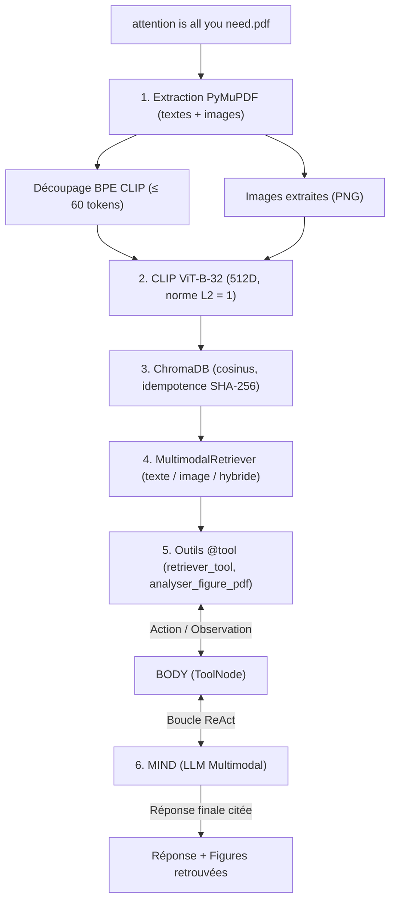

# RAG Multimodal & Agentique (`CLIP + ChromaDB + LangGraph`)

Application modulaire de **RAG multimodal agentique** appliquée à l'article *Attention Is All You Need* (`PyMuPDF` + `OpenCLIP ViT-B-32` + `ChromaDB` + `LangGraph ReAct` + `Gemini / OpenAI`).

---

## Architecture



---

## Couverture du TP

| Étape | Description | Module |
|---|---|---|
| **1** | Extraction PDF par page (texte + images dédupliquées) et découpage BPE CLIP | `src/multimodal_rag/extraction.py`, `chunking.py` |
| **2** | Vectorisation texte & image dans l'espace latent CLIP (`ViT-B-32`, 512D, $L_2=1$) | `src/multimodal_rag/embeddings.py` |
| **3** | Stockage persistant ChromaDB et réindexation idempotente par SHA-256 | `src/multimodal_rag/vector_store.py` |
| **4** | Recherche par similarité cosinus (texte, image, fusionnée, mode `hybride`) | `src/multimodal_rag/retriever.py` |
| **5** | Outils agentiques `@tool` (`retriever_tool`, `analyser_figure_pdf`) | `src/multimodal_rag/tools.py` |
| **6** | Graphe LangGraph ReAct (`mind` ↔ `body`) avec budget d'appels borné | `src/multimodal_rag/agent.py`, `llm.py` |
| **7** | CLI, suite de tests `pytest` et notebook pédagogique exécuté | `src/multimodal_rag/cli.py`, `tests/`, `notebooks/` |

---

## Points clés d'ingénierie IA

- **Respect de la fenêtre CLIP (77 tokens)** : découpage mesuré en tokens BPE (`SimpleTokenizer`, `chunk_size=60`, `chunk_overlap=10`) avec repli BPE strict pour éviter toute troncature.
- **Compensation du *CLIP Modality Gap*** : le mode `"hybride"` équilibre textes et figures dans les résultats au lieu de laisser les scores texte–texte écraser les scores texte–image.
- **Idempotence SHA-256** : chaque réindexation purge les anciens vecteurs du même `document_id` avant `upsert` (`11` pages, `3` images, `216` fragments texte = `219` éléments indexés).
- **Fiabilité & sécurité agentique** : clés API lues uniquement depuis `.env`/environnement, défense contre l'injection de prompt, citations `[nom_du_pdf, p. X]` et abstention vérifiée si l'information manque.

---

## Démarrage rapide

### 1. Prérequis et installation

```powershell
# Copier le modèle de configuration et renseigner GEMINI_KEY (ou GOOGLE_API_KEY / OPENAI_API_KEY)
Copy-Item .env.example .env

# Créer l'environnement Python 3.12 et installer les dépendances
uv sync
```

### 2. Commandes CLI (`multimodal-rag`)

```powershell
# Extraire le PDF et indexer dans ChromaDB
uv run multimodal-rag index

# Rechercher dans la base vectorielle (texte, image, hybride, tous)
uv run multimodal-rag search --text "Scaled Dot-Product Attention" --type hybride -k 4

# Afficher le diagramme Mermaid du graphe ReAct LangGraph
uv run multimodal-rag graph

# Interroger l'agent multimodal (texte et/ou image)
uv run multimodal-rag ask --text "Explique l'attention multi-têtes d'après l'article" --type hybride -k 6
```

### 3. Tests et Notebook

```powershell
# Tests unitaires, d'intégration CLIP/ChromaDB et déterministes LangGraph
uv run pytest tests/test_agent_graph.py tests/test_extraction_chunking.py tests/test_embeddings_store.py -v

# Tests End-to-End complets avec appel LLM réel
uv run pytest tests/test_agent_e2e.py -v
```

- Notebook complet avec sorties exécutées : [`notebooks/tp_rag_multimodal_agentique_solution.ipynb`](./notebooks/tp_rag_multimodal_agentique_solution.ipynb)
